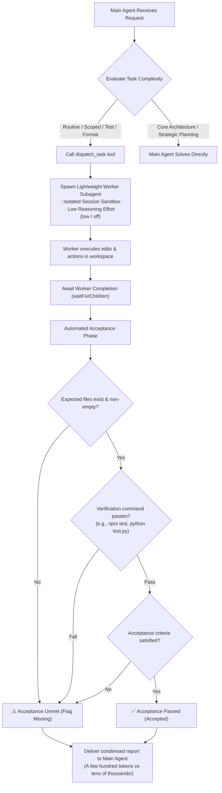

# dsh-subagent-dispatcher

[](LICENSE)
[](https://github.com)
[](package.json)

> 🚀 **DeepSeek Harness (DSH)** plugin for smart subagent task delegation and automated acceptance verification. Offload low-complexity, scoped, or repetitive tasks to lightweight subagents to prevent context bloating and **save 70% ~ 90% tokens and reasoning costs**!

**English** | [中文说明](README.zh.md)

---

## 📌 Table of Contents
- [Why You Need This Plugin](#why-you-need-this-plugin)
- [How It Works](#how-it-works)
- [Quick Start & Installation](#quick-start--installation)
- [Configuration](#configuration)
- [Tool Parameters (`dispatch_task`)](#tool-parameters-dispatch_task)
- [Use Cases & Examples](#use-cases--examples)
- [Token Savings Comparison](#token-savings-comparison)
- [Uninstallation](#uninstallation)

---

## 💡 Why You Need This Plugin

In DeepSeek Harness (DSH), the primary conversation typically employs a high-intelligence, high-reasoning model (such as `DeepSeek-R1`, `DeepSeek-Reasoner`, `gpt-5`, or `max/high` reasoning effort).

When handling **routine, scoped, or low-complexity tasks** (such as writing unit tests, fixing typos, formatting data, or running build commands):
- 🔴 **Context Window Explosion**: Direct exploration, voluminous grep/file dumps, and command outputs quickly inflate the main session to 30k ~ 100k+ tokens.
- 🔴 **Wasted Reasoning Tokens**: High reasoning effort models waste thousands of chain-of-thought (CoT) tokens even on straightforward changes.
- 🔴 **Compounded Ongoing Costs**: Once the primary context expands, every subsequent user turn incurs high prompt cache/input token fees and slower response latency.

### 🌟 Solution

`dsh-subagent-dispatcher` establishes a clean delegation & acceptance loop:
1. **Task Dispatching**: Main Agent delegates routine subtasks to a Worker subagent via `dispatch_task`.
2. **Context Isolation**: The Worker runs within a completely isolated temporary session sandbox. Raw exploratory traces and bash logs **never leak into the parent conversation**.
3. **Reasoning Effort Downgrade**: Subagent runs with low reasoning effort (`low` or `off`), or utilizes a fast and cost-effective model (such as `deepseek-chat` / V3, `gpt-4.1-mini`).
4. **Automated Acceptance & Verification**: Upon confirming subagent completion via `waitForChildren`, the plugin automatically inspects file presence, runs deterministic verification commands (e.g. `npm test`), and validates acceptance criteria.
5. **Condensed Delivery**: Only structured, high-signal results return to the primary agent.

---

## 🔄 How It Works



---

## 🚀 Quick Start & Installation

> **Install from the plugin catalog / npm**: `dsh plugin add dsh-subagent-dispatcher`
> **Install directly from GitHub**: `dsh plugin add github:Ayowait/dsh-subagent-dispatcher`

### Option 1: One-click PowerShell Installer (Recommended)

Open a PowerShell terminal in this plugin directory:

```powershell
powershell -ExecutionPolicy Bypass -File .\install.ps1
```

> **Automated Operations**:
> 1. Injects `dsh-subagent-dispatcher` as a `link:` dependency and bundle into `~/.dsh/profiles/desktop/package.json`.
> 2. Appends configuration into `cordis.patch.yml`.
> 3. Creates automated timestamped backups (`.bak`).

**Restart DeepSeek Harness and it is ready to use!**

---

### Option 2: Manual Installation

1. Open your DSH Desktop profile's `package.json` (typically `~/.dsh/profiles/desktop/package.json`):
   ```json
   {
     "dependencies": {
       "dsh-subagent-dispatcher": "link:/absolute/path/to/dsh-subagent-dispatcher"
     },
     "dsh": {
       "profile": {
         "bundles": [
           "dsh-subagent-dispatcher"
         ]
       }
     }
   }
   ```
2. Append into the profile's `cordis.patch.yml` (`~/.dsh/profiles/desktop/cordis.patch.yml`):
   ```yaml
   - id: dsh-subagent-dispatcher
     name: dsh-subagent-dispatcher
     config:
       toolName: dispatch_task
       defaultReasoningEffort: low
       maxRounds: 3
       autoVerifyFiles: true
   ```
3. Restart DeepSeek Harness.

---

## ⚙️ Configuration

Customizable options in `cordis.patch.yml`:

| Field | Default | Description |
| :--- | :--- | :--- |
| `toolName` | `dispatch_task` | The name of the delegation tool exposed to the model |
| `defaultReasoningEffort` | `low` | Default reasoning effort for subagents (`off`, `minimal`, `low`, `medium`) |
| `defaultModel` | `""` | Optional model ID for subagents (defaults to route inheritance) |
| `defaultProvider` | `""` | Optional provider route |
| `maxRounds` | `3` | Maximum automatic correction rounds within the sandbox |
| `autoVerifyFiles` | `true` | Whether to automatically verify expected file presence and size |
| `verificationTimeoutMs` | `30000` | Timeout for automated verification commands (ms) |

---

## 🛠️ Tool Parameters (`dispatch_task`)

| Parameter | Type | Required | Description |
| :--- | :--- | :---: | :--- |
| `task` | `string` | **Yes** | Detailed description of the delegated task and objective. |
| `acceptance_criteria` | `string` | No | Acceptance criteria checklist (e.g., "Must handle null inputs; all unit tests pass"). |
| `verification_command` | `string` | No | Automated test/verification command (e.g. `npm test`, `node test.js`). Exit code 0 indicates success. |
| `expected_files` | `array` | No | List of relative file paths expected to be created or modified (e.g. `["src/util.js"]`). |
| `model` | `string` | No | Optional lightweight model for the worker (e.g. `deepseek-chat`, `gpt-4.1-mini`). |
| `reasoning_effort` | `string` | No | Reasoning effort level (default `low`, can be `off`). |
| `max_retries` | `number` | No | Maximum retry rounds if acceptance fails (defaults to the `maxRounds` config, i.e. `3`). |

---

## 💻 Use Cases & Examples

### Example: Writing Unit Tests with Verification

```json
{
  "tool": "dispatch_task",
  "arguments": {
    "task": "Write comprehensive unit tests for parseJwtToken in src/auth.js covering valid token, expired token, forged signature, and invalid syntax.",
    "expected_files": [
      "tests/auth.test.js"
    ],
    "verification_command": "npm test -- tests/auth.test.js",
    "acceptance_criteria": "1. Covers all 4 edge cases; 2. Verification command exits with code 0.",
    "reasoning_effort": "low"
  }
}
```

**Condensed report received by the Main Agent**:
```markdown
### ✅ Subagent Task Delivery Report
- **Status**: **Accepted**
- **Rounds**: 1 round
- **Deliverables**: Implemented comprehensive unit tests in `tests/auth.test.js`.
- **Files Modified**: `tests/auth.test.js`
- **Verification**: `npm test -- tests/auth.test.js` passed (Exit code 0).
- **Token Savings**: 💡 Prevented ~12,000+ context and reasoning tokens from flooding the main session.
```

---

## 📊 Token Savings Comparison

| Metric | Traditional (Main Agent in Parent Turn) | This Plugin (Subagent Dispatch + Acceptance) | Gain |
| :--- | :--- | :--- | :--- |
| **Parent Context Bloating** | 20,000 ~ 60,000+ tokens from raw tools & logs | **0 bloating**, receives only concise summary | **95%+ Context Saved** |
| **Reasoning Tokens (CoT)** | Thousands of expensive reasoning tokens per step | Forced `low` or `off` reasoning effort | **80%+ Reasoning Cost Saved** |
| **Subsequent Turn Cost** | Escalating input token fees per turn | Main session stays lean, responsive, and cheap | **Significantly Lower Latency** |
| **Deliverable Reliability** | Risk of unverified code with runtime errors | **Deterministic command acceptance** (`npm test`) | **Higher Quality & Confidence** |

---

## 🗑️ Uninstallation

To restore the original profile state, simply run:

```powershell
powershell -ExecutionPolicy Bypass -File .\install.ps1 -Uninstall
```

The script will restore previous configuration backups cleanly.
