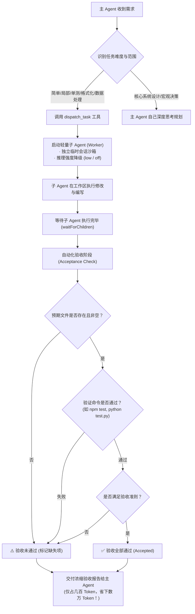

# dsh-subagent-dispatcher (任务分发与自动化验收插件)

[](LICENSE)
[](https://github.com)
[](package.json)

> 🚀 **DeepSeek Harness (DSH)** 专属智能分发与验收插件：将简单或繁琐任务交给轻量子 Agent 独立完成并自动化验收，隔绝主会话上下文污染，**节省高达 70% ~ 90% 的主会话 Token 与推理开销**！

[English](README.md) | **中文说明**

---

## 📌 目录
- [为什么需要这个插件](#为什么需要这个插件)
- [核心工作流程](#核心工作流程)
- [快速安装与启用](#快速安装与启用)
- [配置说明](#配置说明)
- [工具参数说明](#工具参数说明)
- [使用场景与示例](#使用场景与示例)
- [Token 节约效果对比](#token-节约效果对比)
- [卸载方式](#卸载方式)

---

## 💡 为什么需要这个插件？

在 DeepSeek Harness 中，主模型通常使用高智力、高推理思考强度的模型（如 `DeepSeek-R1`、`DeepSeek-Reasoner`、`gpt-5`、`high/max` 推理档位）。

当遇到一些**难度较低但过程繁琐**的任务时（例如：写单测、修个小 Bug、转换数据格式、跑命令查日志）：
- 🔴 **主会话上下文急剧膨胀**：主 Agent 自己看几十个文件、反复跑终端命令打印几千行输出，导致主上下文迅速突破 30k ~ 100k+ Tokens。
- 🔴 **推理 Token 极度浪费**：高思考档位的主模型，哪怕改一个错别字也会产生数千 Token 的 Thinking 思维链。
- 🔴 **后续对话成本倍增**：主上下文膨胀后，每一次后续提问都会承担巨大的 Prompt Cache / Input Token 开销，且响应变慢。

### 🌟 解决方案

`dsh-subagent-dispatcher` 引入任务分发机制：
1. **任务分发 (Dispatch)**：主 Agent 将局部小任务分发给 Worker 子 Agent。
2. **上下文隔离 (Context Isolation)**：子 Agent 在完全独立的临时沙箱会话中执行所有试错与读写，中间成千上万 Token 的调试过程**绝不进入主会话**。
3. **推理强度降级 (Low Reasoning Effort)**：子 Agent 默认采用 `low` 或 `off` 档位，或使用便宜轻量的模型，大幅斩断思考 Token。
4. **自动化验收判定 (Acceptance & Verification)**：在确认子 Agent 真正执行完成后，插件自动核验预期文件存在与完整性、执行自动化测试命令（如 `npm test`），杜绝未经测试的代码直接交付。
5. **浓缩汇报 (Clean Handoff)**：仅向主会话回传精简报告与验收结论，主上下文不被冗余日志污染。

---

## 🔄 核心工作流程



---

## 🚀 快速安装与启用

> **从插件目录 / npm 安装**：`dsh plugin add dsh-subagent-dispatcher`
> **直接从 GitHub 安装**：`dsh plugin add github:Ayowait/dsh-subagent-dispatcher`

### 方式一：一键脚本安装 (推荐)

在当前插件目录打开 PowerShell 终端：

```powershell
powershell -ExecutionPolicy Bypass -File .\install.ps1
```

> **自动化操作**：
> 1. 自动将当前插件以 `link:` 形式挂载到 `~/.dsh/profiles/desktop/package.json` 的 `dependencies` 与 `bundles`。
> 2. 自动在 `cordis.patch.yml` 中追加 `dsh-subagent-dispatcher` 配置。
> 3. 自动生成备份文件（`.bak`）。

**安装完成后，重启 DeepSeek Harness 客户端即可生效！**

---

### 方式二：手动配置安装

1. 打开 DSH 桌面 Profile 的 `package.json`（通常在 `~/.dsh/profiles/desktop/package.json`）：
   ```json
   {
     "dependencies": {
       "dsh-subagent-dispatcher": "link:/你的绝对路径/dsh-subagent-dispatcher"
     },
     "dsh": {
       "profile": {
         "bundles": [
           "dsh-subagent-dispatcher"
         ]
       }
     }
   }
   ```
2. 在 Profile 的 `cordis.patch.yml`（`~/.dsh/profiles/desktop/cordis.patch.yml`）中追加：
   ```yaml
   - id: dsh-subagent-dispatcher
     name: dsh-subagent-dispatcher
     config:
       toolName: dispatch_task
       defaultReasoningEffort: low
       maxRounds: 3
       autoVerifyFiles: true
   ```
3. 重启 DeepSeek Harness。

---

## ⚙️ 配置说明

在 `cordis.patch.yml` 中可自定义以下选项：

| 字段 | 默认值 | 说明 |
| :--- | :--- | :--- |
| `toolName` | `dispatch_task` | 向模型暴露的分发工具名称 |
| `defaultReasoningEffort` | `low` | 子 Agent 默认推理档位（`off`, `minimal`, `low`, `medium`） |
| `defaultModel` | `""` | 子 Agent 默认使用的模型 ID（留空继承默认或由模型选派） |
| `defaultProvider` | `""` | 子 Agent 默认使用的 Provider |
| `maxRounds` | `3` | 验收未通过时的沙箱内自动修正最大轮次 |
| `autoVerifyFiles` | `true` | 是否在验收时自动检查预期文件的存在与大小 |
| `verificationTimeoutMs` | `30000` | 自动化命令执行超时时间 (毫秒) |

---

## 🛠️ 工具参数说明 (`dispatch_task`)

| 参数名 | 类型 | 必填 | 说明 |
| :--- | :--- | :---: | :--- |
| `task` | `string` | **是** | 委派给子 Agent 的具体任务说明与目标要求。 |
| `acceptance_criteria` | `string` | 否 | 任务验收标准清单（例如："必须包含对空输入的单元测试；用例全部通过"）。 |
| `verification_command` | `string` | 否 | 自动化验证命令（例如 `npm test`、`node test.js`、`python -m unittest`）。返回 0 则自动判定通过。 |
| `expected_files` | `array` | 否 | 预期新建或修改的文件列表（如 `["src/util.js", "tests/util.test.js"]`），插件自动校验其完整性。 |
| `model` | `string` | 否 | 指定子 Agent 使用的低成本轻量模型（如 `deepseek-chat` / `gpt-4.1-mini`，留空继承默认）。 |
| `reasoning_effort` | `string` | 否 | 推理强度（默认 `low`，可设为 `off`），强力裁剪思考 Token。 |
| `max_retries` | `number` | 否 | 验收未通过时自动重试修正的上限轮次（默认继承配置 `maxRounds`，即 `3`）。 |

---

## 💻 使用场景与示例

### 示例 1：编写单元测试并自动化验收

```json
{
  "tool": "dispatch_task",
  "arguments": {
    "task": "为 src/auth.js 中的 parseJwtToken 函数编写一套完整的单元测试，覆盖正常 Token、过期 Token、伪造签名及非法格式 4 种情况。",
    "expected_files": [
      "tests/auth.test.js"
    ],
    "verification_command": "npm test -- tests/auth.test.js",
    "acceptance_criteria": "1. 包含 4 种边界用例；2. 测试命令退出码为 0，用例全部通过。",
    "reasoning_effort": "low"
  }
}
```

**主模型接收到的精炼回报**：
```markdown
### ✅ 子Agent任务分发与验收报告
- **任务状态**: **验收通过 (Accepted)**
- **执行与纠错轮次**: 1 轮
- **交付物摘要**: 已在 tests/auth.test.js 中实现完整用例并通过自动化验证。
- **涉及/变更文件**: tests/auth.test.js
- **自动化验收结果**: 验证命令 `npm test -- tests/auth.test.js` 执行成功 (退出码 0)
- **Token 节约评估**: 💡 成功避免约 12,000+ 上下文 Tokens 与 Reasoning Tokens 涌入主会话
```

---

## 📊 Token 节约效果对比

| 对比维度 | 传统方式（主 Agent 直接在主会话做） | 本插件模式（子 Agent 分发 + 验收） | 收益差距 |
| :--- | :--- | :--- | :--- |
| **主会话上下文污染** | 产生大量 `grep`、`read`、`bash` 原始输出，上下文暴增 20,000 ~ 60,000+ Tokens | **0 污染**，仅接收几百 Token 的精炼报告 | **节省 95%+ 上下文** |
| **推理思考 (CoT) 消耗** | 主模型在高档位（`max / high`）下对每个试错轮次输出上千 Token 推理 | 子 Agent 强制使用 `low` 或 `off`，几乎零推理额外开销 | **节省 80%+ 推理费** |
| **主会话后续对话单价** | 后续每一轮对话的 Prompt Cache / Input Token 价格翻倍且反应变慢 | 主会话依然保持极速、轻量、便宜 | **长期会话体验极大提升** |
| **交付确定性** | 容易遇到“写完没跑测试、其实留有 bug” | **强制自动化命令验收**（如 `npm test`），不达标自动在沙箱里打回修复 | **交付质量显著提高** |

---

## 🗑️ 卸载方式

如需恢复初始状态，只需在插件目录执行：

```powershell
powershell -ExecutionPolicy Bypass -File .\install.ps1 -Uninstall
```

系统会自动恢复备份的配置文件。
